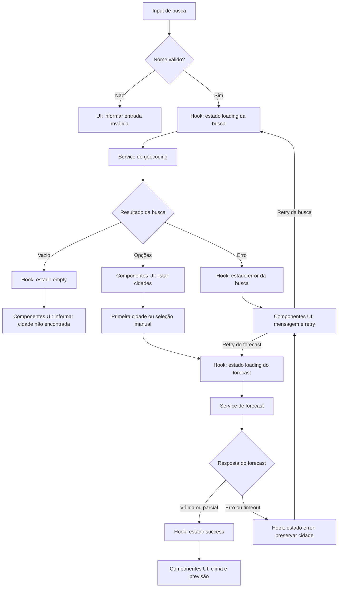

# Plano Técnico — Weather App

Este plano deriva de [`specs/weather-app-spec.md`](../specs/weather-app-spec.md). Ele define a arquitetura e os contratos necessários para decompor tarefas; não é uma implementação. Decisões ainda abertas na especificação estão identificadas como pendências, não como requisitos confirmados.

## Architecture

- Aplicação SPA no cliente, com React e Vite; não haverá servidor próprio, autenticação ou persistência remota no MVP.
- `App.tsx` é o ponto de composição: conecta o hook ao serviço concreto e entrega estado e ações aos componentes.
- `components/` cuida apenas de apresentação e interação. Componentes recebem dados e callbacks; não fazem requisições nem interpretam o JSON da API.
- `hooks/` orquestra busca, seleção, consulta, carregamento, erro, retry e cancelamento de respostas obsoletas. O hook depende do contrato `WeatherService`, não de `fetch` nem de URLs.
- `services/` contém o adaptador Open-Meteo: monta requisições, trata respostas HTTP, valida JSON e normaliza os dados para os tipos internos.
- `lib/` contém funções puras de conversão de temperatura, formatação e descrição local de códigos meteorológicos. Não acessa rede, DOM ou estado React.
- `types/` define os contratos compartilhados entre as camadas, sem lógica de execução.
- Usar `fetch` nativo e estado local do React. Não adicionar roteador, cache, biblioteca de estado ou camada de repositório sem necessidade demonstrada.
- Uma busca com resultados carrega automaticamente a previsão da primeira localidade; a seleção manual permite escolher outra opção.

A direção das dependências fica explícita: `App` compõe hook e componentes; componentes dependem de tipos e funções de apresentação; hooks dependem do contrato do serviço e dos tipos; o serviço depende dos tipos e da API externa; funções em `lib` não dependem de componentes ou serviços. Assim, mudanças na API não se propagam para a UI e regras puras permanecem isoladas.

### Composição com serviço real

- `src/App.tsx` compõe `SearchBar`, `UnitToggle`, os estados e os painéis de clima e previsão. `src/main.tsx` monta a aplicação e importa os estilos globais Tailwind.
- `App` chama `useWeather(service)` sem serviço padrão próprio, permitindo que o hook use a Open-Meteo em produção. O estado inicial `idle` não contém cidade fixa nem dados de demonstração e não faz requisições antes da busca. Fixtures e o serviço local em `src/mocks/` permanecem disponíveis apenas como suporte ao desenvolvimento e aos testes, fora da composição de produção.
- `useWeather(service?)` expõe `status`, `data`, `cities`, `error`, `query` e as ações `search(name)`, `selectCity(city)` e `retry()`. Sem serviço injetado, usa `searchCities` e `getWeather` reais. Uma busca com resultados mantém `loading` até carregar o clima da primeira cidade; sem resultados, termina em `empty`. Retry repete a última ação pública: busca completa ou seleção manual. Entrada vazia retorna a `idle` sem rede; novas ações e desmontagem invalidam respostas obsoletas. A cidade selecionada é preservada como contexto para erros, sem manter previsão antiga como resultado válido.
- `App` mantém `Unit` separadamente dos dados, iniciando em Celsius. Alternar a unidade converte apenas a apresentação atual e diária, sem consultar o serviço nem modificar os dados recebidos.
- O serviço pode ser substituído em testes para simular falhas e respostas pendentes. Testes do fluxo padrão simulam `fetch` ou interceptam HTTP com Playwright, sem chamadas externas. `ErrorState` recebe a mensagem do hook e chama `retry`, preservando o encaminhamento de foco ao conteúdo. Não há controles de simulação nem nomes de cidades especiais para forçar erros na interface.

## Tech Stack

| Área | Decisão |
| --- | --- |
| Linguagem | TypeScript strict, conforme `tsconfig.app.json` |
| UI | React 19 + Vite 8 |
| Estilos | Tailwind CSS 3, seguindo o tema dark glassmorphism do projeto |
| Dados | `fetch` e APIs públicas da Open-Meteo, sem chave no cliente |
| Testes | Vitest, Testing Library e Playwright já declarados no projeto |
| Qualidade | Biome para lint e formatação |
| Runtime de desenvolvimento | Node.js 22 ou superior; pnpm conforme `package.json` |

Não adicionar dependências de produção para requisições HTTP, estado ou datas no MVP.

## Project Structure

Estrutura proposta, compatível com as convenções do projeto. `src/lib/format.ts` já existe e deve ser reaproveitado, sem duplicar sua formatação de datas.

```text
src/
  App.tsx
  components/
    # Apresentação e eventos de usuário; sem acesso direto à API
    CitySearch.tsx
    CurrentWeather.tsx
    ForecastList.tsx
    TemperatureToggle.tsx
    WeatherStatus.tsx
  hooks/
    # Estado e coordenação dos fluxos
    useWeather.ts
  lib/
    # Funções puras e reutilizáveis
    format.ts
    temperature.ts
    weatherCode.ts
  services/
    # Integração e normalização da fonte externa
    openMeteo.ts
  types/
    # Contratos compartilhados entre camadas
    weather.ts
```

Cada componente React fica em seu próprio arquivo. Os testes ficam fora de `src/`: `tests/unit/` para funções e adaptadores, `tests/integration/` para hook e componentes, e `tests/e2e/` para fluxos completos, conforme `playwright.config.ts`.

Essa separação reduz o custo de teste: `lib/` é testada como função pura; `services/` usa `fetch` simulado para verificar parâmetros e normalização sem rede real; `hooks/` recebe um `WeatherService` falso para cobrir estados, retry e respostas obsoletas; `components/` é exercitada com Testing Library sem Open-Meteo; Playwright valida a integração do fluxo com as chamadas externas interceptadas.

## Data Model

Os dados da API são normalizados uma vez no serviço. Campos meteorológicos que a fonte não retornar são `null`, nunca zero. Datas diárias permanecem strings `YYYY-MM-DD` da localidade, sem conversão para instante UTC.

```ts
/** Unidade usada para apresentar temperaturas. */
export type Unit = 'celsius' | 'fahrenheit';

export interface City {
  /** Identificador da localidade retornado pela geocodificação, quando disponível. */
  id?: number;
  /** Nome da cidade retornado pela Open-Meteo. */
  name: string;
  /** Região administrativa (admin1), usada para distinguir cidades homônimas. */
  region?: string;
  /** País da localidade. */
  country: string;
  /** Código ISO do país, quando retornado pela fonte. */
  countryCode?: string;
  /** Latitude usada para consultar a previsão. */
  latitude: number;
  /** Longitude usada para consultar a previsão. */
  longitude: number;
  /** Fuso horário da localidade, quando retornado pela fonte. */
  timezone?: string;
}

export interface CurrentWeather {
  /** Temperatura atual normalizada para Celsius; null se ausente. */
  temperatureC: number | null;
  /** Código WMO da condição atual; null se ausente. */
  weatherCode: number | null;
  /** Umidade relativa em porcentagem; null se ausente. */
  humidityPercent: number | null;
  /** Velocidade do vento em km/h; null se ausente. */
  windSpeedKmh: number | null;
  /** Precipitação em milímetros; null se ausente. */
  precipitationMm: number | null;
  /** Pressão atmosférica em hPa; opcional para compatibilidade com dados existentes. */
  pressureHpa?: number | null;
}

export interface ForecastDay {
  /** Data local da previsão no formato YYYY-MM-DD. */
  date: string;
  /** Temperatura mínima normalizada para Celsius; null se ausente. */
  minTemperatureC: number | null;
  /** Temperatura máxima normalizada para Celsius; null se ausente. */
  maxTemperatureC: number | null;
  /** Código WMO da condição diária; null se ausente. */
  weatherCode: number | null;
}

export interface WeatherData {
  /** Localidade escolhida à qual estas condições pertencem. */
  city: City;
  /** Condições atuais retornadas pela fonte. */
  current: CurrentWeather;
  /** Previsão diária, com datas preservadas na ordem retornada. */
  forecastDays: ForecastDay[];
}
```

`weatherCode` conserva o código WMO fornecido pela fonte; uma função de apresentação o mapeia para texto em pt-BR. Código desconhecido ou ausente não deve ser descrito como uma condição inventada. A interface de serviço e o parser recebem JSON como `unknown` e validam a estrutura antes de construir esses tipos.

O painel de clima atual recebe `city`, `current` e `unit`. Usa `lib/weatherCodes` para rótulos e ícones e `lib/temperature` para conversão. Apresenta temperatura com até uma casa decimal em pt-BR, preservando a precisão no domínio. Pressão usa hPa; `pressureHpa` ausente ou `null` é exibido como indisponível, assim como as demais métricas ausentes. A integração futura deve normalizar `surface_pressure` para esse campo, sem inferir pressão a partir de outras métricas.

Conversão de temperatura é uma função pura, aplicada a todos os campos atuais e diários:

```ts
export function convertTemperature(
  valueC: number,
  unit: Unit,
): number;
```

Usar $F = C \times 9/5 + 32$ e manter precisão no modelo. A regra de arredondamento visual continua pendente na spec; não arredondar silenciosamente os valores do domínio. Os casos de 0 °C e 100 °C precisam produzir exatamente 32 °F e 212 °F antes da formatação.

## Data Flow

1. A pessoa envia o nome da cidade. O cliente remove espaços externos e impede consulta para entrada vazia ou inválida.
2. O hook inicia geocodificação e apresenta carregamento. Uma lista vazia termina em ausência de resultados; respostas válidas viram opções com contexto regional disponível.
3. O hook consulta clima atual e previsão diária da primeira opção, sem sair de `loading`. A pessoa pode selecionar outra localidade depois, usando as coordenadas dessa nova opção.
4. O serviço valida e normaliza os dados. Valores opcionais ausentes viram `null`; as datas recebidas são mantidas em ordem e associadas aos próprios valores, sem deslocar os dias.
5. A interface apresenta clima atual e até cinco posições diárias (hoje e os quatro dias seguintes), conforme os dados retornados. A unidade escolhida só altera a apresentação das temperaturas.
6. Em nova tentativa, o hook repete a busca ou a consulta meteorológica original. Falha de previsão mantém identificada a cidade selecionada, mas não mistura dados de consultas anteriores.



## External APIs

### Geocodificação

**URL**

```text
GET https://geocoding-api.open-meteo.com/v1/search?name={query}&language=pt&format=json
```

`name` deve ser codificado como componente de URL. `language=pt` solicita nomes em português e `format=json` fixa o formato da resposta. O endpoint não usa `current`, `daily` ou `timezone`; pode retornar `timezone` em cada localidade.

**Exemplo resumido de resposta**

```json
{
  "results": [
    {
      "id": 3448439,
      "name": "São Paulo",
      "latitude": -23.55,
      "longitude": -46.63,
      "timezone": "America/Sao_Paulo",
      "country_code": "BR",
      "country": "Brasil",
      "admin1": "São Paulo"
    }
  ]
}
```

Mapear cada item de `results` para `City`: `id`, `name`, `latitude`, `longitude`, `timezone` e `country` mantêm seus significados; `country_code` vira `countryCode` e `admin1` vira `region`. Campos geográficos opcionais continuam opcionais. Uma resposta bem-sucedida sem resultados vira `[]`, não erro; o limite e a ordenação permanecem pendentes (Open Question 7 da spec). O hook usa a primeira localidade na ordem retornada para carregar o clima automaticamente.

### Previsão

**URL**

```text
GET https://api.open-meteo.com/v1/forecast?latitude={latitude}&longitude={longitude}&current=temperature_2m,relative_humidity_2m,precipitation,weather_code,wind_speed_10m&daily=temperature_2m_min,temperature_2m_max,weather_code&forecast_days=5&timezone=auto&temperature_unit=celsius&wind_speed_unit=kmh&precipitation_unit=mm
```

Parâmetros principais: `latitude` e `longitude` da cidade selecionada; `current` seleciona os campos de condições atuais; `daily` seleciona mínima, máxima e código WMO por dia; `forecast_days=5` solicita hoje e os quatro dias seguintes; `timezone=auto` pede datas e horários no fuso da coordenada. As unidades fixam os dados recebidos em Celsius, km/h e mm.

**Exemplo resumido de resposta**

```json
{
  "timezone": "America/Sao_Paulo",
  "current_units": {
    "temperature_2m": "°C",
    "relative_humidity_2m": "%",
    "precipitation": "mm",
    "weather_code": "wmo code",
    "wind_speed_10m": "km/h"
  },
  "current": {
    "time": "2026-10-29T14:00",
    "temperature_2m": 22.4,
    "relative_humidity_2m": 65,
    "precipitation": 0,
    "weather_code": 2,
    "wind_speed_10m": 11.2
  },
  "daily_units": {
    "time": "iso8601",
    "weather_code": "wmo code",
    "temperature_2m_min": "°C",
    "temperature_2m_max": "°C"
  },
  "daily": {
    "time": ["2026-10-29", "2026-10-30", "2026-10-31", "2026-11-01", "2026-11-02"],
    "weather_code": [2, 3, 61, 3, 1],
    "temperature_2m_min": [15.1, 16.0, 17.2, 16.4, 15.8],
    "temperature_2m_max": [25.3, 24.7, 23.1, 25.0, 26.2]
  }
}
```

**Mapeamento para o modelo interno**

| Resposta Open-Meteo | Campo interno | Regra |
| --- | --- | --- |
| Localidade selecionada pela pessoa | `WeatherData.city` | Reutilizar o `City` produzido pela geocodificação. |
| `current.temperature_2m` | `current.temperatureC` | Receber em Celsius por `temperature_unit=celsius`; ausente vira `null`. |
| `current.weather_code` | `current.weatherCode` | Preservar o código WMO; a apresentação traduz o código separadamente. |
| `current.relative_humidity_2m` | `current.humidityPercent` | Valor numérico em porcentagem; ausente vira `null`. |
| `current.wind_speed_10m` | `current.windSpeedKmh` | Receber em km/h por `wind_speed_unit=kmh`; ausente vira `null`. |
| `current.precipitation` | `current.precipitationMm` | Receber em mm por `precipitation_unit=mm`; `null` explícito vira `0`; campo omitido ou valor inválido vira `null`. |
| `daily.time[i]` | `forecastDays[i].date` | Preservar a data local ISO, sem conversão para UTC. |
| `daily.temperature_2m_min[i]` / `daily.temperature_2m_max[i]` | `forecastDays[i].minTemperatureC` / `maxTemperatureC` | Associar pelo mesmo índice `i`; campo ausente vira `null`. |
| `daily.weather_code[i]` | `forecastDays[i].weatherCode` | Associar pelo mesmo índice `i`; ausente vira `null`. |

Construir `forecastDays` percorrendo `daily.time` e lendo os demais arrays pelo mesmo índice. Não compactar arrays nem deslocar datas quando um valor estiver ausente. As unidades em `current_units` e `daily_units` podem ser verificadas pelo parser; os nomes de unidade não substituem a conversão definida pelos parâmetros da requisição.

Celsius é a unidade canônica recebida do serviço; alternar para Fahrenheit não repete a requisição. `timezone=auto` e as datas diárias retornadas atendem provisoriamente ao requisito de usar as datas da localidade. Confirmar essa regra de fuso antes da entrega final, conforme Open Question 13. Não apresentar horário de atualização se a fonte não o fornecer.

### Contrato interno

```ts
export interface WeatherService {
  searchLocations(query: string, signal?: AbortSignal): Promise<City[]>;
  getWeather(
    location: City,
    signal?: AbortSignal,
  ): Promise<WeatherData>;
}
```

As duas operações usam as funções de `src/services/weatherService.ts`. O serviço trata status HTTP, parsing e normalização; componentes não conhecem URLs nem o formato bruto da API. A resposta de previsão inclui a `City` consultada em `WeatherData.city`. Não há segredo ou variável de API key no cliente.

## State Management

O estado da consulta vive em memória no hook `useWeather`, usando `useReducer` para tornar explícitas as transições de busca, seleção, previsão e retry. `App` mantém separadamente o estado `Unit`, inicializado em Celsius e não persistido entre visitas. Nenhum desses estados vai para servidor ou armazenamento local no MVP.

```ts
export type WeatherStatus = 'idle' | 'loading' | 'success' | 'error' | 'empty';

interface WeatherState {
  status: WeatherStatus;
  data: WeatherData | null;
  cities: City[];
  error: string | null;
  query: string;
  selectedCity: City | null;
}

type Operation =
  | { kind: 'search'; query: string }
  | { kind: 'select'; city: City };
```

`idle` representa a tela sem consulta; `loading` cobre busca e previsão; `success` contém `data`; `empty` significa busca concluída sem cidades; `error` expõe a mensagem retornada pelo serviço. `cities` conserva as opções e `selectedCity` identifica a localidade consultada mesmo se a previsão falhar. `query` armazena o termo aparado. O hook retorna esses campos e `search`, `selectCity`, `retry`; a última `Operation` fica em uma ref. Retry de busca repete geocodificação e previsão automática; retry de seleção refaz apenas a previsão escolhida. Entrada vazia retorna a `idle`, limpa a última operação e não chama a API. Iniciar outra ação limpa `data` e `error`; um identificador por execução ignora respostas obsoletas e respostas posteriores à desmontagem.

A unidade nunca altera o modelo armazenado: `CurrentWeather` e `ForecastDay` permanecem em Celsius. Durante a renderização, converter cada temperatura não nula com `convertTemperature(valueC, unit)` e formatar o resultado. Alterar C/F atualiza apenas o estado de `Unit` e provoca novo render; não chama `WeatherService` nem dispara outro request. Valores `null` permanecem indisponíveis e não passam pela conversão.

## Error Handling

- **Rede (`network`):** falha de conexão ou `fetch` rejeitado. Encerrar `loading`, informar que não foi possível carregar e oferecer retry.
- **API (`api`):** status HTTP não bem-sucedido ou payload que declara erro. Mostrar mensagem simples, sem detalhes internos; oferecer retry para falhas recuperáveis (por exemplo, 429 ou 5xx), mas não para erros de requisição que exigem correção.
- **Timeout (`timeout`):** aplicar `fetchWithTimeout` às requisições de geocodificação e previsão, com `AbortController` e limite de 10 segundos. Converter `AbortError` em `WeatherServiceError` de tipo `timeout`, com mensagem `A requisição demorou demais.`; falhas de rede usam `Falha de rede.`. Limpar o timer em `finally`, tanto em sucesso quanto em erro. Sair de `loading` e oferecer retry; cancelamento externo por nova busca ou desmontagem permanece uma responsabilidade separada.
- **Resposta inválida (`invalid-response`):** JSON ilegível ou estrutura incompatível com o contrato. Não tratá-la como sucesso nem inventar valores; retry só quando a falha puder ser recuperada.
- **Resposta parcial:** validar a estrutura geral e normalizar cada campo ausente para `null`. Manter os valores válidos e marcar como indisponíveis os campos ausentes, nunca como zero. Ausência de campos opcionais de umidade, vento ou precipitação não invalida a consulta. Se faltar temperatura ou código de condição atuais, manter os dados úteis, mas marcar `completeness: 'partial'` e comunicar que a consulta está incompleta; não apresentá-la como previsão completa. Dias/campos incompletos permanecem associados às datas originais.
- **Busca sem resultados (`empty`):** não é erro; não solicitar forecast e não mostrar dados meteorológicos de outra localidade.
- **Falha de previsão:** conservar a localidade resolvida na mensagem/ação de retry; não apresentar dados de outra cidade.
- Não manter o spinner após falha, não fazer retry automático, não adicionar cache nem fallback para dados antigos no MVP.

## Testing Strategy

- **Unitários (Vitest):** conversão C/F, formatação de datas, mapeamento de códigos WMO, parser/normalizador da API, tratamento de valores ausentes e transições do reducer. Cobrir 0 °C → 32 °F e 100 °C → 212 °F.
- **Integração (Testing Library):** busca com primeira cidade automática e seleção manual de alternativas, localidades homônimas, carregamento, ausência de resultados, clima parcial, erro e nova tentativa; alternar unidade atualiza todas as temperaturas sem mudar cidade ou datas.
- **E2E (Playwright):** fluxos principais de busca até previsão e alternância de unidade, com chamadas à Open-Meteo interceptadas para resultados determinísticos. Exercitar Chromium desktop e o projeto mobile já configurados.
- **Qualidade não funcional:** verificar navegação por teclado, nomes/papéis semânticos, contraste e layout a partir de 320 px. Medir a tela inicial contra os 2 segundos do RNF-01 somente depois de acordar o perfil de rede e o método de medição; o limite de rapidez da busca permanece sem número.
- Testes automatizados não dependem de disponibilidade externa nem de chamadas reais durante CI.

## Risks & Trade-offs

| Risco ou trade-off | Tratamento no plano | Pendência/impacto |
| --- | --- | --- |
| Limites, licença, atribuição ou disponibilidade da Open-Meteo | Isolar chamadas no serviço; validar termos antes da publicação. | Pode exigir mudança operacional ou de fonte (RNF-06). |
| Significado de “clima atual” e obrigatoriedade de campos | Modelar extras como opcionais e preservar dados parciais. | Confirmar campos obrigatórios e semântica antes de fechar testes (Open Questions 1 e 2). |
| Cidades homônimas e limite de resultados | Carregar a primeira localidade e apresentar alternativas com contexto para seleção manual. | Confirmar contexto disponível, quantidade e ordenação (Open Questions 7 e 8). |
| Fuso, virada de data e previsão incompleta | Usar `timezone=auto`, datas ISO da API e slots associados por data. | Confirmar fuso da cidade versus dispositivo; datas ausentes da própria fonte limitam o que pode ser exibido (Open Question 13). |
| Timeout, desempenho e busca “rápida” sem limites completos | Cancelamento explícito, estados recuperáveis e medição separada. | Definir duração do timeout, perfil de rede e métrica de busca (RNFs 01 e 04; Open Questions 21 e 22). |
| Arredondamento e unidades além de temperatura | Manter valores canônicos e conversão somente de temperatura. | Definir arredondamento e confirmar tratamento de vento/precipitação (Open Question 12). |
| Escopo de acessibilidade e compatibilidade ainda genérico | Semântica, teclado, contraste e testes responsivos desde o início. | Confirmar WCAG, navegadores e versões mínimos (RNFs 03 e 07; Open Questions 19 e 20). |
| Simplicidade versus robustez de estado | Reducer local, sem cache ou biblioteca externa; cancelamento para respostas obsoletas. | Adicionar infraestrutura somente se requisitos futuros (persistência/offline) forem aprovados. |
